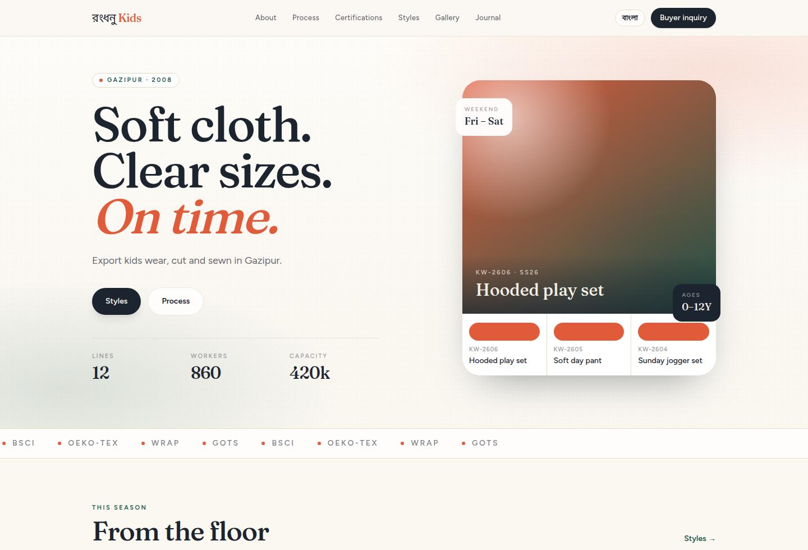
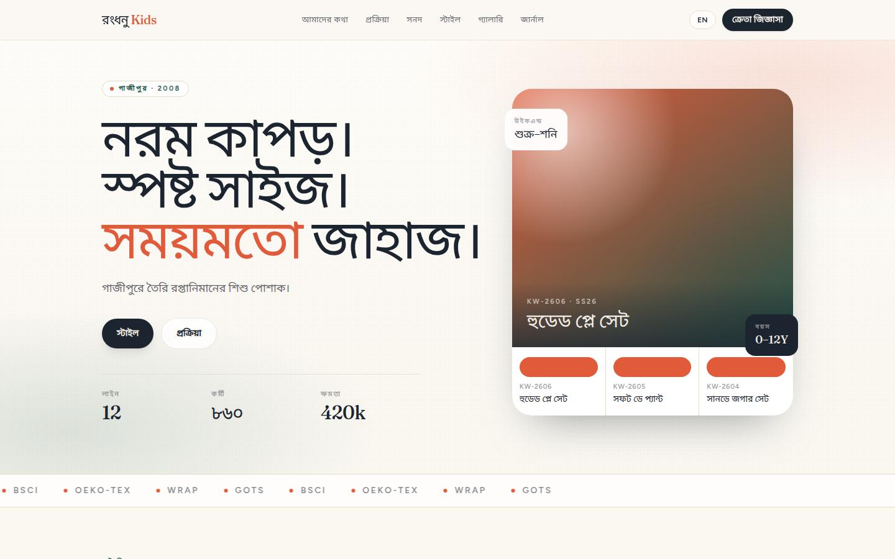
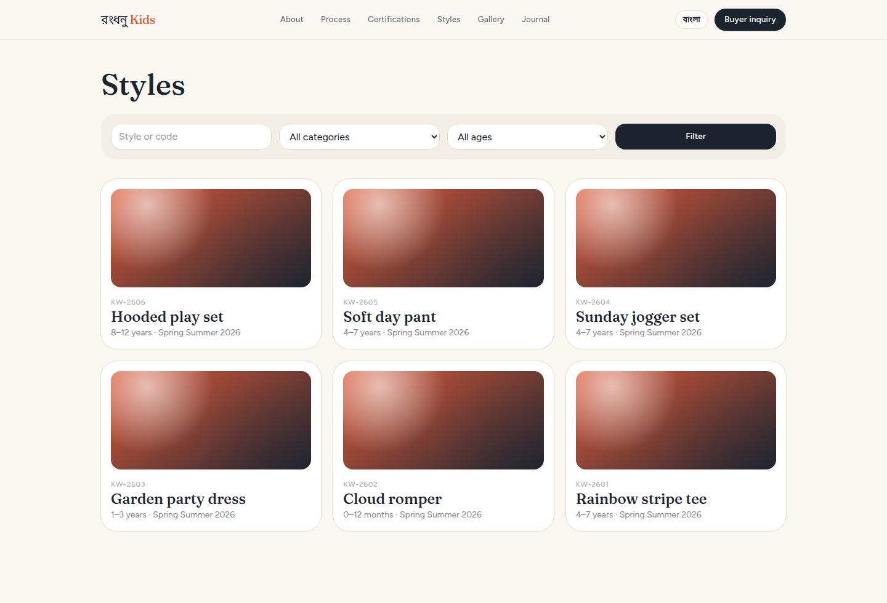
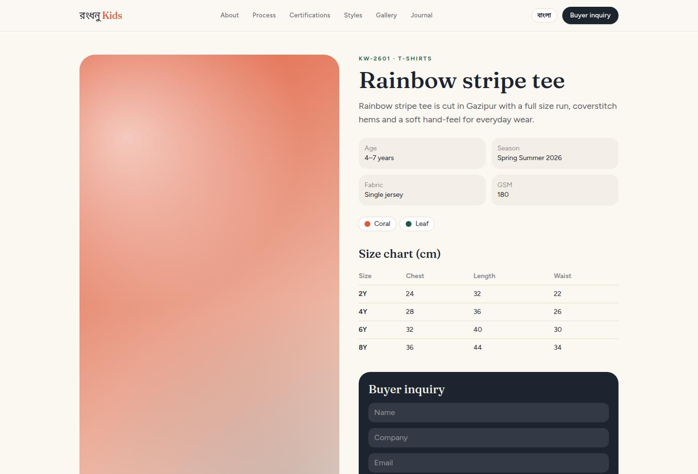
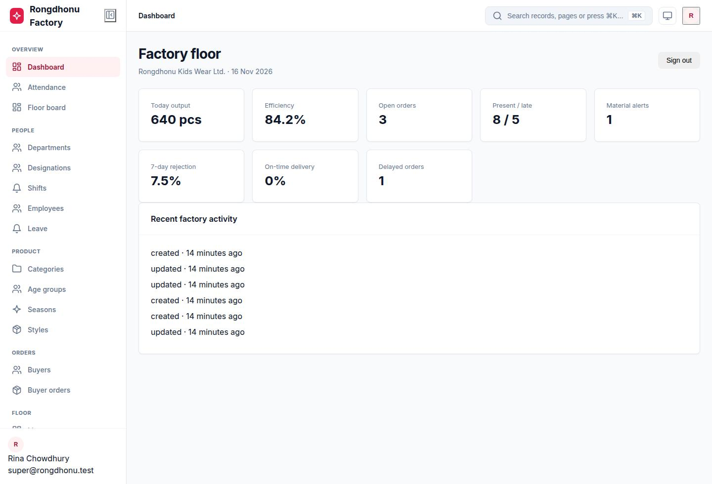
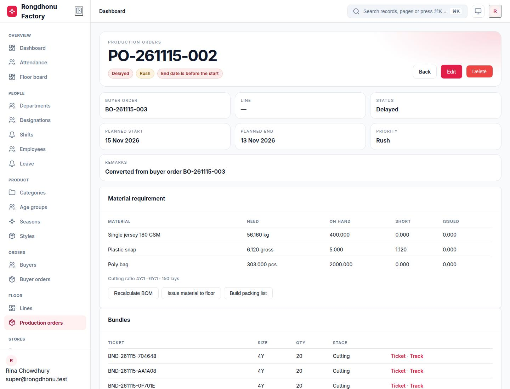
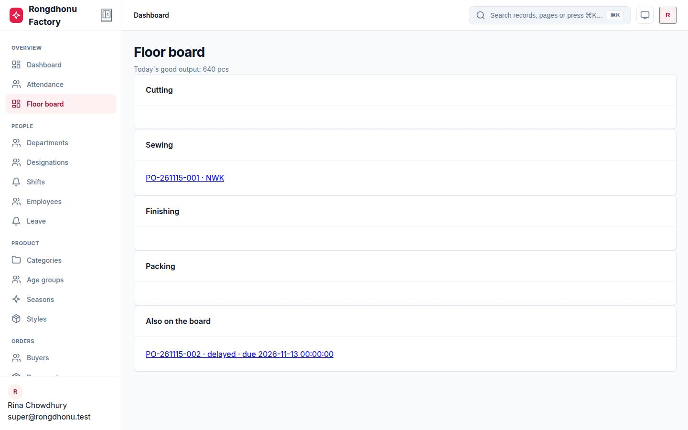
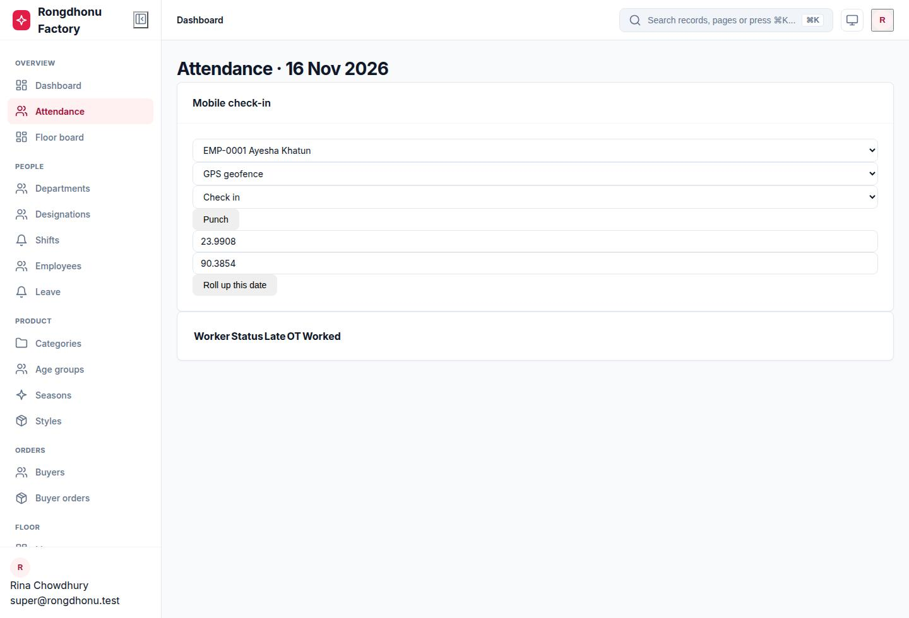

# Rongdhonu Kids Wear

Factory software for a children's apparel plant. Styles, size runs, buyer orders, the sewing floor, stores, quality, fabric buying, costing, and a public site in English and Bengali live in one place.

Built for the way a Gazipur export floor actually works: Friday–Saturday weekend, ages from `0-3M` to `12Y`, a size matrix on every order, and documents a buyer can read in বাংলা or English.



| | |
| --- | --- |
| Framework | Laravel 12, PHP 8.2+ |
| Desk | Light and dark admin shell, nine roles |
| Site | English `/en` and Bengali `/bn` |
| Database | SQLite to try it, MySQL for the plant |
| Demo | `super@rongdhonu.test` / `password` |

## Who this is for

A kidswear factory that still runs the day from an attendance book, a merchandiser's Excel file, a paper production board, and a stack of tech packs. The same style code should carry the size chart, the bill of materials, the buyer quantity, the bundles on the line, the inspection, and the invoice.

Rongdhonu Kids Wear Ltd. in this repository is a seeded Konabari plant: 12 lines, tees, rompers, sets, dresses, and pants, buyers in Sweden, the UK, Spain, and Bangladesh. Replace the company profile and you are looking at your own floor.

## Hours this puts back

These are typical desk hours the paper version of the same job takes in a kidswear plant. They are planning figures, not a stopwatch study of one factory.

| The slow job today | What the system does | Time a desk usually gets back |
| --- | --- | --- |
| Attendance book closed at the gate, late marks added at night | GPS or QR punch, then a shift rollup for late, early leave, and overtime | 45–90 minutes a day for HR |
| Buyer PDF retyped into Excel, size by size | OCR reads the file into a draft order when the style code and sizes are on the page | 20–40 minutes an order |
| Fabric need worked out on a calculator from the BOM | Material requirement from the production quantity, consumption, and wastage | 1–2 hours an order |
| Bundle tickets written by hand and lost between cutting and sewing | Bundles of 20 with a code, a stage, and a public track link | The hunt for a missing bundle |
| Production board wiped and rewritten each morning | Floor board by cutting, sewing, finishing, packing, plus today's good output | 30–60 minutes a morning |
| QC sheets collected at the end of the week | Inline and final inspections, kidswear defect types, a 7-day rejection rate | Defects show the same day |
| Commercial invoice and packing list typed in Word | Unicode PDF from the order, Bengali preset included | 30–60 minutes a shipment |
| "Where is style KW-2601?" answered from a folder | Public style page with age, season, colorway, and size chart | The first meeting with a buyer |
| Low fabric noticed when the line stops | Reorder alert on the dashboard, shortage on the production order | A stopped line |
| Delay noticed when the ship date has passed | Delayed status, nightly alert to the super admin and factory manager | The evening meeting |

A plant that confirms a few export orders a week and runs attendance for a few hundred workers is looking at **most of a merchandiser's afternoon and most of an HR clerk's morning**, every week, moved off paper.

## See the plant

### The site a buyer opens

The English home page. Capacity, weekend, age range, and the season's lead style are on the first screen.


The same page in Bengali. Navigation, headline, stats, and style names switch with the locale.



Styles filter by words, category, and age group. Seasons are on the same catalog.



A style page carries the age, season, fabric, GSM, colorways, the kids size chart, and a buyer inquiry tied to that style.



### The desk the floor uses

Sign in and the morning numbers are already there: output, efficiency, open orders, who is present and late, material alerts, rejection, on-time delivery, and delayed orders.



Confirming a buyer order opens a production order, explodes the BOM, and cuts the size run into bundles. This one is already flagged delayed, with plastic snaps short by 1.12 gross and a 4Y:1 / 6Y:1 marker.



The floor board is the paper board, by stage. Today's good output sits at the top.



Attendance is a punch, not a notebook. GPS uses the Konabari gate. Late minutes and overtime come from the shift.



## What the business can do

### Show the factory before the meeting

- Home, about, process, certifications, gallery, journal, contact.
- Certifications for BSCI, OEKO-TEX, WRAP, and GOTS, each with a validity date.
- Catalog filters for category, age group, and season, plus search on name or style code.
- Style URLs from the name (`/en/styles/rainbow-stripe-tee`), with meta title, description, and Product JSON-LD.
- Organization JSON-LD on the home page, a sitemap, and `robots.txt`.
- Buyer inquiry on the style page and a general contact form. Buyer inquiries require a company name.
- A public bundle page at `/track/{code}` so a buyer or a supervisor can see the stage without a login.

### Keep every kids size visible

Sizes in the system: `0-3M`, `3-6M`, `6-12M`, `1Y`, `2Y`, `3Y`, `4Y`, `5Y`, `6Y`, `7Y`, `8Y`, `9Y`, `10Y`, `11Y`, `12Y`.

- Age groups from 0–12 months through 8–12 years.
- A size matrix on the buyer order, the production order, the invoice, and the packing list.
- A cutting plan that reduces the run to the smallest marker ratio and the number of lays. `2Y 400 / 4Y 600 / 6Y 600 / 8Y 400` becomes `2:3:3:2` over 200 lays.
- Bundles split at 20 pieces, each with its own code, size, and stage.
- Body measurements stored per size: chest, length, waist, and anything else you add on the style.

### Take a buyer order through to a shipment

- Buyers with country, currency, and payment terms.
- Draft, confirmed, in production, shipped, closed, cancelled.
- Add a size run with a unit price. Confirming the order creates the production order, copies the lines, calculates material, and generates bundles. Doing it twice does not create a second production order.
- A commercial invoice and a packing list as Unicode PDFs.
- Reports for efficiency, style profitability, attendance, inventory value, and buyer performance, each as a page, an Excel file, and a PDF.

### Run the floor without a whiteboard

- Lines with an hourly target and a supervisor.
- Stages: cutting, sewing, finishing, packing.
- Daily targets against achieved quantity.
- Record good pieces and rejects for a bundle or the whole order.
- Packing output lands in finished goods by style, color, size, and location.
- An order becomes completed when packed quantity covers the order, and delayed when the planned end has passed.

### Stop guessing fabric

- Materials for fabric, trim, accessory, and packing, with GSM, last cost, and a reorder level.
- Locations for the store, the cutting floor, and finished goods.
- Stock receipts, issues to a production order, and a movement history.
- Bill of materials per style: consumption per piece and wastage percent.
- The production order shows need, on hand, short, and issued.
- Issuing stock refuses the move when the store cannot cover it.
- Purchase orders, goods receipt (GRN), and supplier lead time.
- The dashboard counts materials sitting at or under the reorder level. In the demo, snaps are the alert.

### Catch a kidswear defect while the bundle is still on the line

Defects seeded for this trade: open seam, shade variation, measurement deviation, needle damage, broken snap, oil stain. Severity runs critical, major, minor.

- Inline, end-line, and final inspections.
- Sample size, accepted, rejected, AQL, result pass / fail / hold.
- Photos on the inspection.
- A note from AI Hub when a provider is configured. With no key, the desk still saves the checklist and records why the suggestion did not arrive.
- Seven-day rejection rate on the dashboard. The nightly job tells the factory manager when that rate is high.

### Price a style before you promise a buyer

FOB is fabric + trim + CM + washing + print + packing + overhead, then the margin. The demo styles already have a costing sheet. Change the numbers on the style and the FOB recalculates.

### Know which machine is down

- Machines on a line, with brand and status running / idle / breakdown.
- A maintenance task with a frequency and a next due date.
- A breakdown log with start, end, reason, downtime minutes, and what was done.
- Overdue maintenance is part of the nightly alert scan.

### Employ the floor, not a second register

- Departments, designations, shifts, employees, leave types, leave requests, holidays.
- Employee codes `EMP-0001` upward. That code is what the attendance device stores.
- Two demo shifts: General 08:00–17:00 with 10 minutes grace, and an overtime shift.
- A punch inside the geofence, or a QR punch, then an immediate rollup.
- Status comes back as present, late, half day, or absent, with late minutes, early leave, worked minutes, and overtime.
- Bangladesh holidays in the seed: Language Martyrs' Day, Independence Day, Pohela Boishakh, May Day, Victory Day.
- The factory calendar treats Friday and Saturday as the weekend.

## Nine seats, one factory

| Seat | Email | What they are here to do |
| --- | --- | --- |
| Super Admin | super@rongdhonu.test | Everything, including settings and backups |
| Factory Manager | manager@rongdhonu.test | The same operational range as the super admin |
| Production Supervisor | supervisor@rongdhonu.test | Floor, orders, quality view, maintenance view |
| Quality Controller | qc@rongdhonu.test | Inspections and defect lists |
| Inventory Manager | inventory@rongdhonu.test | Stock, purchase orders, receipts |
| Sales | sales@rongdhonu.test | Buyers, orders, styles, the public site |
| HR | hr@rongdhonu.test | People, shifts, leave, attendance |
| Accounts | accounts@rongdhonu.test | Costing, invoices, reports |
| Viewer | viewer@rongdhonu.test | Look, not change |

Every password in the demo is `password`.

A viewer who tries to create a style is refused. Switching a module off under Settings hides it. Settings itself stays available, so you can turn a module back on.

Critical saves write an activity row named `factory`. People, styles, orders, materials, inspections, invoices, machines, and journal posts soft-delete, so a mistaken delete can be recovered.

## What runs without someone remembering

- **18:10** scan for delayed orders, low stock, a high rejection rate, and overdue maintenance. Super admins and factory managers get a database notification and an email.
- **20:15** attendance rollup for every active worker.
- Confirming a buyer order builds the production order, the material requirement, and the bundles in one step.
- Issuing material writes stock movements and updates what is still short.
- Receiving a purchase order writes a GRN and puts the quantity on hand.
- Packing a bundle increases finished goods.
- OCR intake stores the file, extracts the text, and opens a draft buyer order when it can match a style and a size run such as `2Y 400`.
- The AI style desk writes a merchandising draft from a keyword. With a provider key it uses AI Catalog. Without one, it still opens a local draft.
- PDF generation, alerts, and the backup job are queued. Run a worker in production.

```bash
php artisan queue:work
php artisan schedule:work
```

## Where you can take it

The modules are switches, not a rewrite. A smaller plant can run HR, styles, and orders first, and turn on quality, buying, and maintenance when the floor is ready.

Already shaped for the next step:

- **A second language on every public page.** English and Bengali are routes, not a plugin. Add another locale in `config/kidswear.php` and a language file.
- **A buyer's own language on the PDF.** The Unicode PDF preset is Bengali-capable. Install the Bengali font and local challans and invoices can carry বাংলা.
- **A real biometric gate.** Attendance Hub speaks GPS, QR, and the device drivers in that package. The punch is stored against the employee code, so a ZKTeco-style device maps onto the same rollup.
- **Live AI.** AI Catalog, AI Hub, and AI OCR are installed. Add the provider keys and the style desk, the inspection note, and the order intake start calling the model. Until then they fail softly.
- **WhatsApp or SMS later.** Notifications already go to the database and mail. A channel can be added without touching the alert rules.
- **More than one shed.** Locations, lines, and stock lots are already separate records.
- **A buyer who tracks a carton.** Every bundle has a public code.
- **A quotation from the costing sheet.** FOB is calculated, not typed.
- **Speed notes.** Drutogoti is installed and off. Turn on `DRUTOGOTI_ENABLED` after its tables are migrated and the settings page lists what it finds.
- **A backup you can hand to IT.** The settings page queues one. On SQLite it copies the database file.

Studios, when their own config allows them: `/ai-hub`, `/ai-catalog`, `/ai-ocr`.

## Try it

```bash
composer install
cp .env.example .env
php artisan key:generate
touch database/database.sqlite
php artisan migrate --seed
npm install
npm run build
php artisan serve
```

Open `/en` for the site and `/admin` for the desk.

`php artisan kidswear:install` migrates and seeds. `php artisan kidswear:install --fresh` wipes the database first.

```bash
php artisan test
```

## Packages

| Package | What the plant uses it for |
| --- | --- |
| `imrandevbd/laravel-admin-panel` | Light and dark desk, sidebar, cards |
| `imrandevbd/laravel-attendance-hub` | GPS and QR punches, late and overtime math |
| `imrandevbd/laravel-ai-catalog` | Style listing drafts from a keyword |
| `imrandevbd/laravel-ai-hub` | Quality and delay notes |
| `imrandevbd/laravel-ai-ocr` | Buyer-order text and PDF intake |
| `imrandevbd/laravel-unicode-pdf` | Invoices, packing lists, reports, bundle tickets |
| `imrandevbd/laravel-universal-slug` | Style, category, and journal URLs |
| `imrandevbd/tarikh` | Factory dates. The package has no service provider, so Composer does not auto-discover it |
| `imrandevbd/drutogoti` | Optional speed notes on the settings page |
| `spatie/laravel-permission` | Roles and permissions |
| `spatie/laravel-activitylog` | The factory audit log |
| `spatie/laravel-medialibrary` | Style photos, tech packs, inspection photos |

`laravel-blueprint-studio` is optional and is not installed. Its published archive was not available when this project was built. `maatwebsite/excel` is not installed because PhpSpreadsheet does not yet allow PHP 8.5. Reports still download as real `.xlsx` files.

The admin package is the shell. Lists, forms, and the order, floor, and store actions live in `app/Modules/KidsWear` and render inside that shell. Laravel 12 is the ceiling for the attendance, admin, and Drutogoti packages used here.

## How the code is arranged

```
app/Modules/KidsWear/
  Admin/          desk navigation and resource definitions
  Catalog/        styles, BOM, size charts, AI drafts
  Dashboard/      morning KPIs
  Finance/        costing, invoices, packing lists
  Hr/             people, shifts, attendance rollup
  Inventory/      stock and issues
  Maintenance/    machines, schedules, breakdowns
  Orders/         buyers and the conversion into production
  Procurement/    suppliers, purchase orders, GRN, OCR
  Production/     bundles, stages, material requirement
  Quality/        inspections and defect types
  Settings/       company profile and module flags
  Support/        size matrix, cutting plan, calendar, PDF and Excel helpers
  Website/        journal, gallery, inquiries, certifications
```

Each module can be enabled or disabled from Settings. The permission name is `{module}.view` and `{module}.manage`.

## On a real server

SQLite is the default so a laptop can run the demo. Production should use MySQL:

```
DB_CONNECTION=mysql
DB_HOST=127.0.0.1
DB_PORT=3306
DB_DATABASE=kidswear
DB_USERNAME=kidswear
DB_PASSWORD=
```

Then `php artisan migrate --seed`.

Set the app timezone to `Asia/Dhaka` if the punches and the 18:10 alert should follow Bangladesh time. The weekend helper already treats Friday and Saturday as off.

Point the queue at `database` or Redis and keep a worker running. Schedule the two daily jobs with cron:

```
* * * * * cd /path/to/app && php artisan schedule:run >> /dev/null 2>&1
```

For Bengali PDFs, install a Bengali font through the Unicode PDF package. Without it, the document still generates and the Latin face stands in.

AI and OCR need no keys to install. Add the provider keys from each package when you want live generation. The sample factory gate for GPS is Konabari, Gazipur: latitude `23.9908`, longitude `90.3854`, radius 250 metres, in `config/kidswear.php`.

Company name, address, phone, and which modules are on are edited in the desk under Settings. The backup button queues a copy of the SQLite file. On MySQL it records a note rather than dumping the server.

## Let's connect and collaborate

I am open to Senior Remote Full-Stack Roles, AI Platform Architecture Contracts, and Enterprise Technical Advisory.

**Timezone:** UTC+6 (Dhaka / Rangpur, Bangladesh). Flexible overlap with US, UK, and European business hours.

**Delivery:** Async-ready, on Slack, Discord, Jira, and GitHub, with production-first accountability.

| Channel | Address | Quick action |
| --- | --- | --- |
| 🌐 Primary portfolio | [imrandev.bd](https://imrandev.bd) | [Visit site](https://imrandev.bd) |
| 📦 Packagist packages | [packagist.org/packages/imrandevbd](https://packagist.org/packages/imrandevbd/) | [View packages](https://packagist.org/packages/imrandevbd/) |
| 💼 LinkedIn | [linkedin.com/in/imranbru99](https://linkedin.com/in/imranbru99) | [Connect](https://linkedin.com/in/imranbru99) |
| 🐙 GitHub | [github.com/imranbru99](https://github.com/imranbru99) | [Follow](https://github.com/imranbru99) |
| 💬 WhatsApp | [+880 1576-918420](https://wa.me/8801576918420) | [Chat now](https://wa.me/8801576918420) |
| 📧 Email | [me@imrandev.bd](mailto:me@imrandev.bd) | [Send email](mailto:me@imrandev.bd) |
| 🐦 X | [@imrandev_bd](https://x.com/imrandev_bd) | [Follow](https://x.com/imrandev_bd) |
| 📺 YouTube | [@ImranDevBD](https://www.youtube.com/@ImranDevBD) | [Subscribe](https://www.youtube.com/@ImranDevBD) |
